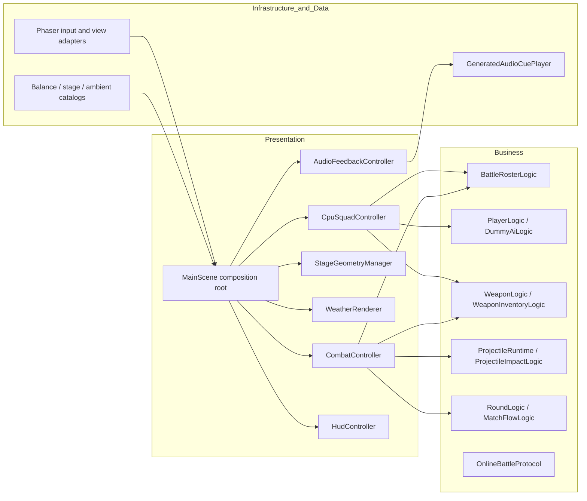
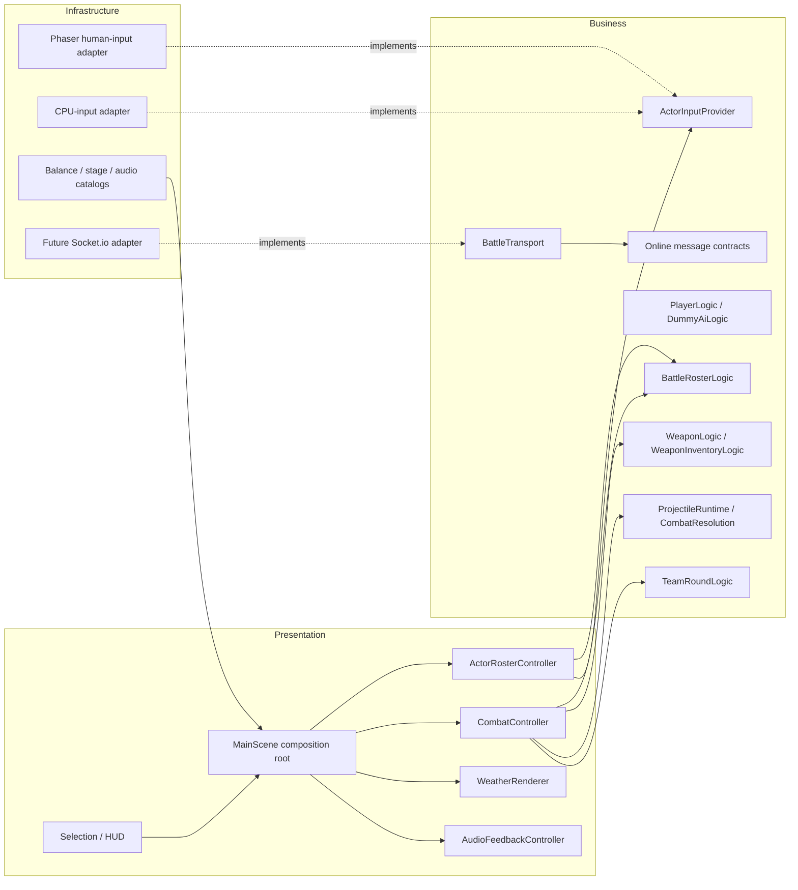
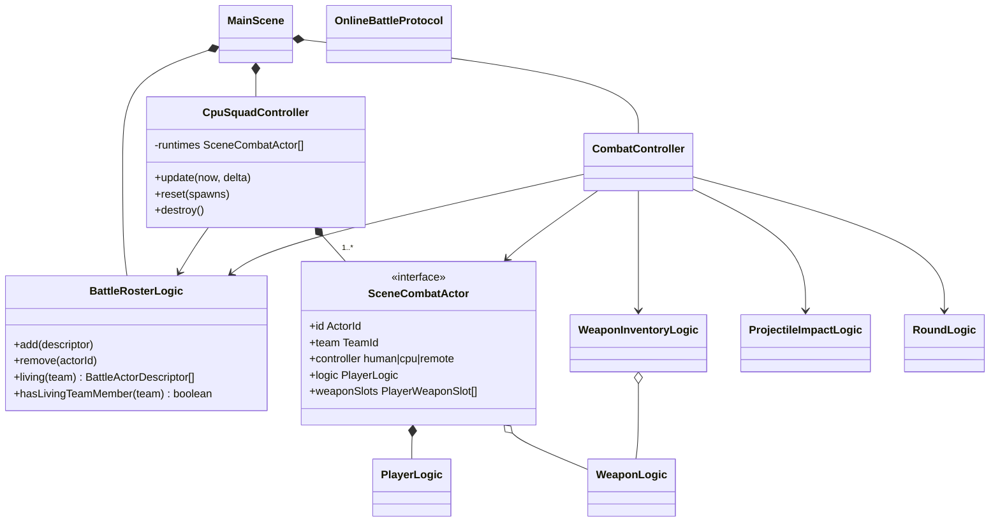
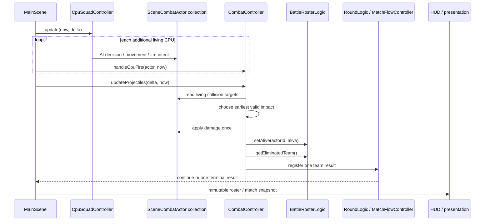
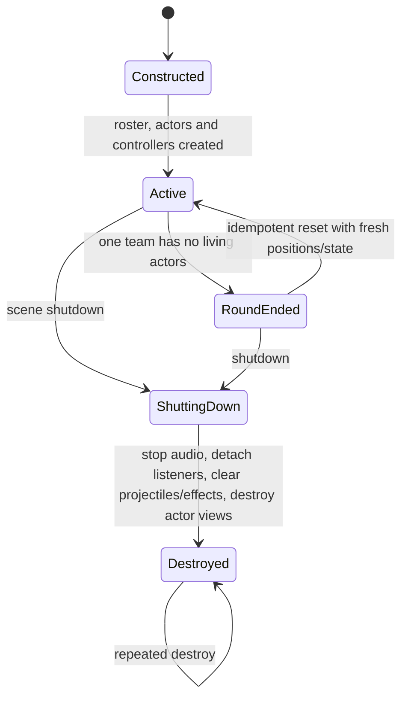

# Combat Roster and Online Readiness Design

## Intent

Turn the current hard-coded player-versus-one-dummy runtime into a verified
combat foundation that can run one human against three independent CPU actors,
while preserving the already passing reload, weather, and generated-audio
features. Define an authoritative online protocol boundary without claiming
that a hosted multiplayer service exists.

The active Phaser + TypeScript + Vite workspace is authoritative. Existing
uncommitted work is preserved and treated as the current implementation
baseline.

## Current-state audit

| Capability | Current evidence | State before this slice |
| --- | --- | --- |
| Reload, fire, ammo | `WeaponLogic`, `CombatController`, and focused tests | Implemented for the player and one dummy; lifecycle edge cases need explicit regression coverage |
| Projectile hit/damage | `ProjectileRuntime`, `CombatResolution`, actor/map collision paths | Implemented for exactly two actors; endpoint collision and actor/obstacle ordering require investigation |
| Weather | `WeatherLogic`, `WeatherRenderer`, stage selection and browser tests | Five states implemented; selected-stage application and reset require fresh integrated evidence |
| Map background music | `AmbientAudioCatalog`, generated Web Audio player and controller | Eight synthesized motifs implemented in the dirty worktree; audible scheduling/lifecycle needs browser evidence |
| Human versus CPU | One `PlayerLogic`, one `DummyAiLogic`, one target sprite | Playable 1v1 only; selection accepts an enemy count but runtime does not own a roster |
| Online teams | No transport, lobby, server, session, or reconciliation module | Unsupported |
| Object separation | Strong pure domain modules, but scene controllers retain player/dummy assumptions | Partially compliant |

## Goals

- Preserve ammo conservation and deterministic reload/fire behavior across
  switching, death, round reset, and exact reload boundaries.
- Resolve every projectile impact at most once, with explicit team filtering,
  obstacle precedence, cover behavior, dead-target behavior, and cleanup.
- Apply selected weather to domain state and presentation, reset it without
  stale effects, and retain wind/gameplay coupling.
- Resolve every selectable map to its intended synthesized looping music,
  start only after user interaction, switch on stage change, honor volume, and
  stop on scene shutdown.
- Support one local human against three CPU enemies. Each enemy owns its own
  identity, health, AI state, weapon inventory/reload state, presentation, and
  collision target. A round ends only when one team has no living actors.
- Add replaceable input and transport contracts so human, CPU, replay, and
  future remote inputs are polymorphic without importing Phaser into domain
  code.
- Document module communication honestly: local modules use typed in-process
  calls/events; future online communication uses versioned WebSocket messages
  and server-authoritative RPC/event semantics. There is no OS-process IPC in
  the current browser application.
- Produce an evidence-backed capability matrix and architecture/UML handoff.

## Non-goals

- No claim of deployed many-versus-many online play in this slice.
- No matchmaking, account authentication, anti-cheat, persistence, global
  ranking, regional hosting, or production operations.
- No wholesale ECS conversion, Phaser replacement, or rewrite of the passing
  stage, actor atlas, world-object, weather, or audio systems.
- No third-party image or audio acquisition.
- No balance change outside the new local 1v3 mode unless a failing correctness
  test requires it.

## Constraints and quality attributes

- Preserve existing routes and 1v1 behavior.
- Scene simulation remains single-threaded and deterministic for a supplied
  time step. Presentation never decides damage or match results.
- Domain modules must not import Phaser, DOM, Web Audio, WebSocket, storage, or
  concrete adapters.
- A new actor must be addable without adding another set of `dummy2`/`dummy3`
  fields to `MainScene` or `CombatController`.
- Scene-owned actors, audio loops, listeners, effects, and transport adapters
  have idempotent teardown.
- Network messages are size-bounded, versioned, sequenced, validated, and
  rejected fail-closed. The server, when built, is the only authority for
  damage, ammo, death, score, and match results.
- Existing dirty files and generated evidence remain untouched unless the
  current slice has a demonstrated reason to update them.

## Approaches considered

### 1. Duplicate the existing dummy fields and loops

This is the shortest route to drawing three enemies, but it multiplies the
current `player|dummy` branching, makes collision ordering harder to prove,
and creates no usable online boundary. Rejected.

### 2. Replace the scene with an ECS and build networking at the same time

This creates a uniform long-term model, but it is a broad rewrite of a runtime
with 477 passing tests and would mix gameplay migration with distributed-system
failure modes. Rejected for this slice.

### 3. Introduce a roster and ports as one vertical slice

Keep the existing domain rules, represent participants through stable actor and
team identities, let a scene-owned roster compose per-actor domain/presentation
resources, and adapt combat/match resolution to collections. Add pure online
message and transport contracts now, then implement the hosted adapter only
after deployment decisions. Chosen because it produces playable 1v3 progress,
improves object boundaries, and gives future online work a testable seam.

## As-built layer and component map

The following diagram names only classes/modules present in `src` in this
slice. Solid arrows are current in-process calls or injected dependencies.



`GeneratedAudioCuePlayer` currently lives under `domain/audio` for historical
reasons but directly owns Web Audio nodes and timers, so its architectural role
is an infrastructure adapter. Moving its file is a later cleanup, not a claim
that Web Audio is domain logic.

## Target layer and component map (not yet implemented)

This diagram is the intended hosted-online boundary. `ActorInputProvider`,
`ActorRosterController`, `TeamRoundLogic`, `BattleTransport`, and its socket
adapter are design contracts/future components; they are not present in the
current runtime.



Allowed dependencies remain `Presentation -> Business <- Infrastructure`.
The scene is the composition root. Infrastructure implements business-owned
interfaces; domain types never depend on adapters.

## Core contracts

### Actor identity and roster

```ts
type ActorId = string & { readonly __actorId: unique symbol };

interface BattleActorDescriptor {
  readonly id: ActorId;
  readonly team: TeamId;
  readonly controller: "human" | "cpu" | "remote";
}

interface BattleRosterView {
  all(): readonly BattleActorDescriptor[];
  living(team?: TeamId): readonly BattleActorDescriptor[];
  opponentIds(team: TeamId): readonly ActorId[];
  hasLivingTeamMember(team: TeamId): boolean;
}
```

`BattleRosterLogic` owns identity uniqueness, team membership, and elimination
queries. It does not own sprites, Phaser physics, or WebSocket connections.

### Proposed input-provider polymorphism (future)

```ts
interface ActorCommand {
  readonly sequence: number;
  readonly moveX: number;
  readonly moveY: number;
  readonly aimRadians: number;
  readonly fire: boolean;
  readonly reload: boolean;
  readonly weaponSlot: number | null;
}

interface ActorInputProvider {
  sample(actorId: ActorId, tick: number): ActorCommand;
  reset(actorId: ActorId): void;
  destroy(): void;
}
```

Human and CPU providers run locally on the scene thread. A future remote
provider consumes validated server snapshots; it does not get authority to
apply damage locally.

### Combat targets

`CombatController` depends on a scene-owned combat-target view instead of
player/dummy singleton fields. A target supplies identity, team, current bounds,
alive state, and commands to apply domain damage and presentation feedback.
The controller resolves a projectile against the earliest blocking collision,
filters its owner and team, applies damage once, and removes or reflects the
projectile once.

### Implemented online protocol and proposed transport

```ts
type OnlineClientMessage =
  | { v: 1; type: "join"; requestId: string; roomId: string; preferredTeam?: TeamId }
  | { v: 1; type: "input"; actorId: string; sequence: number; clientTick: number; command: ActorCommand }
  | { v: 1; type: "leave"; requestId: string };

type OnlineServerMessage =
  | { v: 1; type: "joined"; requestId: string; actorId: string; team: TeamId; serverTick: number }
  | { v: 1; type: "snapshot"; sequence: number; serverTick: number; actors: readonly ActorSnapshot[] }
  | { v: 1; type: "event"; sequence: number; event: AuthoritativeBattleEvent }
  | { v: 1; type: "rejected"; requestId?: string; code: OnlineErrorCode };

interface BattleTransport {
  connect(signal: AbortSignal): Promise<void>;
  send(message: OnlineClientMessage): void;
  subscribe(listener: (message: OnlineServerMessage) => void): () => void;
  close(): void;
}
```

The message unions, validators, bounds, and `InputSequenceGuard` above are
implemented in `OnlineBattleProtocol`. `BattleTransport` is a proposed port;
there is no concrete transport, connection lifecycle, or server in this slice.

Validation rejects unknown versions/types, invalid actor/team IDs, non-finite
coordinates, oversized room/request IDs, non-monotonic input sequences, and
oversized actor collections. The future transport must additionally bound raw
message bytes, make `send` fail predictably before connection/after close, and
make `close` and unsubscribe idempotent.

## Object responsibility map

| Object family | Single responsibility | Boundary |
| --- | --- | --- |
| Weapon | ammo, cadence, reload, weapon-specific shot result | Business |
| Character | health, movement, stun, aim and death state | Business |
| Battle actor | stable identity, team and controller kind | Business |
| Inventory | slot ownership, unlock/equip policy | Business |
| Projectile/collision | trajectory and earliest-impact resolution | Business, rendered by Presentation |
| Collision effect | short-lived visual/audio response to an immutable outcome | Presentation |
| Map | stage definition, spawn/object layout | Business/Data |
| Weather | gameplay multipliers and transition state | Business; particles/overlay in Presentation |
| Audio | semantic cue/motif selection | Business/Data; Web Audio playback in Presentation adapter |
| Actor roster | identity/team membership and aggregate elimination | Business; resource ownership in scene controller |
| Match | team score and terminal result | Business |
| Online protocol | versioned messages, validation and sequence guard | Business contract; transport is future Infrastructure |

Inheritance is not required for actors. The current runtime uses composition
through `SceneCombatActor` and injected controller dependencies; the proposed
`ActorInputProvider` and `BattleTransport` ports extend that polymorphism to
future input/online adapters. State remains private to its owner and is exposed
through immutable snapshots or focused commands.

## As-built class view



## As-built local 1v3 sequence



## Future authoritative online sequence

```mermaid
sequenceDiagram
  actor User
  participant Client as Phaser client
  participant Transport as BattleTransport adapter
  participant Server as Authoritative battle service
  participant Peers as Other clients

  User->>Client: input
  Client->>Transport: versioned sequenced command
  Transport->>Server: WebSocket input message
  Server->>Server: validate identity, sequence, rate and room
  Server->>Server: fixed-tick simulate movement/fire/hit/ammo
  Server-->>Transport: snapshot + authoritative events
  Server-->>Peers: same ordered snapshot/events
  Transport-->>Client: validated message
  Client->>Client: interpolate presentation; never author damage
```

The future server owns room capacity, ticks, damage, ammo, death, score, and
disconnect outcomes. Clients may predict movement/weapon feel, then reconcile
to snapshots. They cannot submit hit or damage results.

## State and lifecycle



Local execution has no worker thread. Phaser input, simulation, Web Audio
scheduling, and view mutation occur on the scene thread. A future network
adapter owns its async connection and abort signal but marshals validated
messages into a bounded queue drained by the scene update. Overflow closes the
connection rather than growing memory without bound.

## Composition and ownership

`MainScene` constructs and owns, in order: stage/map services, actor roster,
combat, match flow, weather, audio, and presentation/HUD. A future online slice
would add an optional transport.
Shutdown runs in reverse dependency order:

1. stop accepting input and abort/close optional transport;
2. stop ambient/weather audio and detach HUD/listeners;
3. cancel effects/tweens and clear projectiles;
4. destroy actor presentation and input providers;
5. release stage/map/weather resources.

Every destroy path is idempotent. No singleton or service locator is added.

## Failure model

- Invalid local selection falls back to the established 1v1 defaults.
- A malformed protocol message returns a typed rejection or closes the future
  transport; it never mutates simulation state.
- A duplicate or stale sequence is ignored deterministically.
- An actor already dead cannot receive further damage, fire, or reload.
- A projectile resolved against an actor, obstacle, cover, or map object is
  removed/reflected once and cannot apply two outcomes in one frame.
- Weather/audio reset uses explicit clear/stop semantics; old loops and particle
  state must not survive restart.
- A CPU actor failure is isolated to that actor; roster/match evaluation remains
  defined and teardown still completes.

## Verification gates

1. Pure domain tests: roster identity/team rules, team elimination, input and
   online message validation, sequence monotonicity, and lifecycle idempotency.
2. Focused combat tests: reload boundaries/switch/death/reset, swept impact,
   owner/team filtering, obstacle precedence, one damage event, projectile
   cleanup, and all-opponents-dead result.
3. Focused weather/audio tests: map selection, transitions/reset, all map motifs,
   volume, duplicate suppression, and shutdown.
4. Browser tests: real input reload/fire/hit, selected weather, map/BGM debug
   state, playable 1v3 elimination and restart without actor/listener leaks.
5. Full gates after the latest edit: type-check, lint, all unit tests, build,
   full Playwright, independent reviewer, manual drift, and postflight.

Protocol contract tests prove online readiness only. A deployed many-versus-many
claim additionally requires a server implementation, multi-browser
interoperability, latency/loss/reconnect tests, authentication/authorization,
hosting health/rollback evidence, and a named operational owner.

## Risks and rejected shortcuts

- `CombatController` and `MainScene` are already large; new collection behavior
  must be extracted rather than increasing their singleton branching.
- High-speed endpoint-only collision can tunnel through an actor. The chosen
  implementation must compare the projectile segment against actor/map bounds
  and select the earliest blocking impact.
- Rendering three enemies is not 1v3 unless each has independent domain and
  weapon state and team elimination is aggregate.
- Calling typed local functions "IPC" would obscure the deployment boundary.
  Only a future separate service uses RPC/event transport.
- Generated Web Audio motifs are background music behavior, but they are not a
  mastered soundtrack asset; evidence and product copy must retain that
  distinction.

## Ordered implementation slices

1. Capture current behavior with focused tests and fix only proven
   reload/fire/hit correctness defects.
2. Add actor identity, roster, team-result, and protocol contracts with pure
   tests.
3. Extract scene actor-roster ownership and implement local 1v3 while preserving
   the 1v1 route.
4. Bind combat/projectiles/HUD/reset to the roster and verify aggregate match
   completion.
5. Re-verify weather and map-motif audio in the integrated browser runtime.
6. Update capability/progress evidence, run full deterministic gates, obtain
   independent review, drift check, and postflight.

## Deferred service decisions

Before a hosted online adapter is implemented, the next product-owner gate must
fix: maximum team/room size, guest versus account identity, matchmaking versus
invite rooms, disconnect/forfeit/rejoin policy, region and hosting target,
server tick/snapshot rates, latency budget, deployment secrets, monitoring,
abuse/rate limits, and operations ownership. The repository's older stack note
mentions Socket.io and Fly.io/Railway, but that note alone is not deployment
authorization or current provider evidence.
